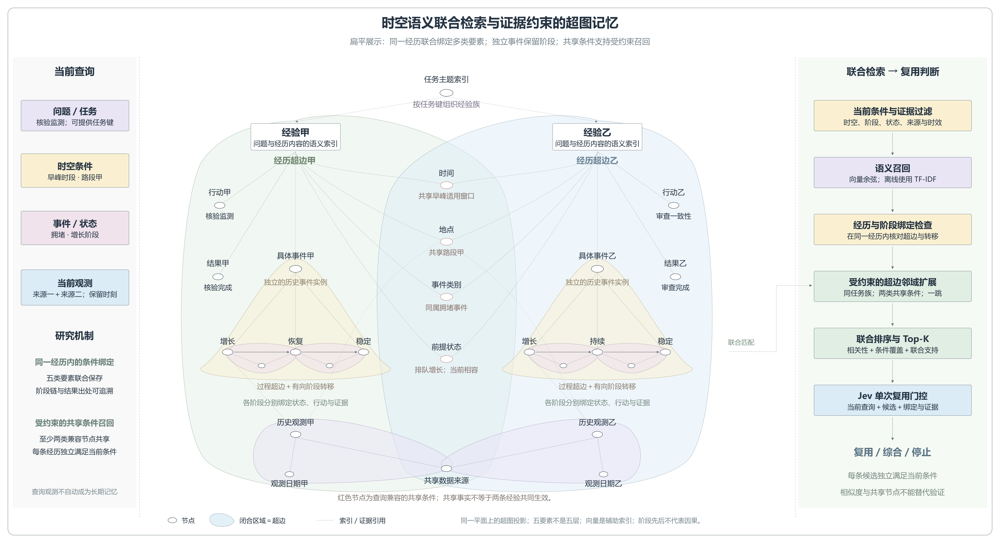

# 时空语义联合检索与证据约束的超图记忆

此为上一版单平面展示。当前推荐使用 [分层扁平结构图](hypergraph-memory-layered-flat.md)，按主题、经历、事件阶段、事实证据四层横向展开。

此为当前实现的推荐图。用户要求的“扁平”指将共享节点与交叠超边放在同一平面展示，不再画为四层金字塔；不表示改成没有关系的平面文本存储。主题入口仍按任务键索引不同经历，各自连接具体事件和阶段。

绿色、蓝色包络表示两条 episode 经历超边，联合关联时间、地点、事件类别、行动、结果及相应过程。红色小节点突出当前查询兼容的共享时间、地点、事件与前提状态。它们是共同的上下文锚点，不表示两条经历共同生效，也不表示当前观测验证了所有历史结果。

经验甲与乙的矩形是 Record 索引及语义编码入口，不新增节点种类。向量辅助索引持久化在 embedding_cache 表中；默认本地 TF-IDF。两个“具体事件”是不同 namespace/case_id 对应的 process 实例；事件类别相同也不会合并实例。阶段转移含明确源与目标，但不等于因果发现。

历史观测保留独立日期和出处。底部紫色包络及虚线引用强调观测的时间、来源及空间关联，是为可读性简化的成员投影，并非按区域几何包含穷尽完整数据库成员；完整 observation 超边始终联合绑定观测、来源、实体与观测时刻。左侧当前查询中的观测是本次证据输入，不自动写入长期记忆。

右侧流程对应新实现：当前条件与证据硬过滤→相关性召回→同一经历与阶段链绑定检查→受约束的单跳超边扩展→联合排序 Top-K→Jev 单次复用判断。扩展只允许在每条候选独立满足条件后，经至少两种查询兼容的节点类型共享召回；共享主题或来源不足以扩展。实际复用仍须通过 Jev 和输出前的有效性复核。

详细算法、配置、平面对照及示例见 [联合检索说明](../../JOINT_RETRIEVAL_GUIDE.md)。图表达已实现机制与研究设计，不代表已证明效果优于现有方法。

可编辑 SVG：hypergraph-memory-flat-joint.svg。高清 PNG：4560 × 2480。重绘脚本：draw_memory_flat_joint.py。
