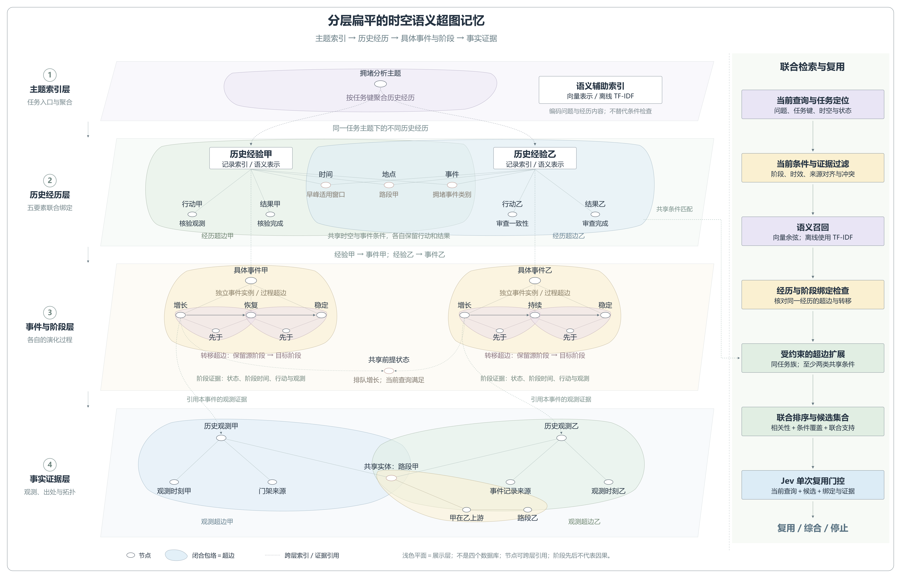

# 分层扁平的时空语义超图记忆

本图按用户要求将四个展示层自上向下排列，每层横向展开为一个浅色平面。浅色平面只是层次引导，不是超边；其中的彩色闭合包络才表示超边。这样保留主题到具体经历、事件与证据的索引主干，同时避免将整个结构画成一张大包络图。

1. **主题索引层**：按任务键聚合不同历史经历。语义辅助索引用于编码问题与经历内容，支持可选向量模型或离线 TF-IDF；它是辅助索引，不是新的记忆层或自动语义主题聚类。
2. **历史经历层**：episode 超边联合关联时间、地点、事件、行动和结果。两条经历通过共享适用时间、空间实体和事件类别交叠，同时保留各自的行动与结果。经验矩形是 Record 索引，不是新的节点种类。
3. **事件与阶段层**：经验甲、乙分别关联各自的 process 事件实例；每个实例内部横向排列阶段，state_transition 超边以明确源→目标关系连接相邻阶段。相邻转移共同引用同一个中间阶段节点。共享状态通过虚线关联各自的入口阶段；阶段证据还包括行动、阶段时间与观测。
4. **事实证据层**：两条 observation 超边分别保存观测、来源、观测时间及实体，交叠于同一个空间实体。空间关系超边连接该实体、另一实体及有向关系描述。不同来源、日期独立保留，当前查询是否支持复用还需要单独进行证据校验。

跨层虚线是索引或成员引用的展示投影，不是另外新增的普通二元边。分层会把同值节点在不同展示位置画成引用，例如经历层的路段甲和证据层的路段甲；实际数据库仍通过确定性标识复用节点。主题聚合与 episode 的完整成员跨越多个展示层，局部包络突出该层成员，不表示完整成员只能落在该层的几何区域内。

右侧流程对应当前代码：任务定位→当前条件与证据过滤→相关性召回→同一经历与阶段绑定检查→相同任务族内、至少两类兼容共享节点的单跳扩展→联合排序→Jev 单次复用门控。输出前还会复核当前条件及图绑定。结构与实现详见 [联合检索说明](../../JOINT_RETRIEVAL_GUIDE.md)。

这四层是逻辑展示视图，不是四个数据库，也没有修改智能体的存储或检索代码。当前结构仍为十八类节点、八类超边，SQLite schema 5（包括向量缓存辅助表），图快照版本 3。图中交通实例为示例；阶段先后不代表因果，图示不证明学术新颖性或性能优越。

高清 PNG：4480 × 2880。可编辑 SVG：hypergraph-memory-layered-flat.svg。生成脚本：draw_memory_layered_flat.py。
