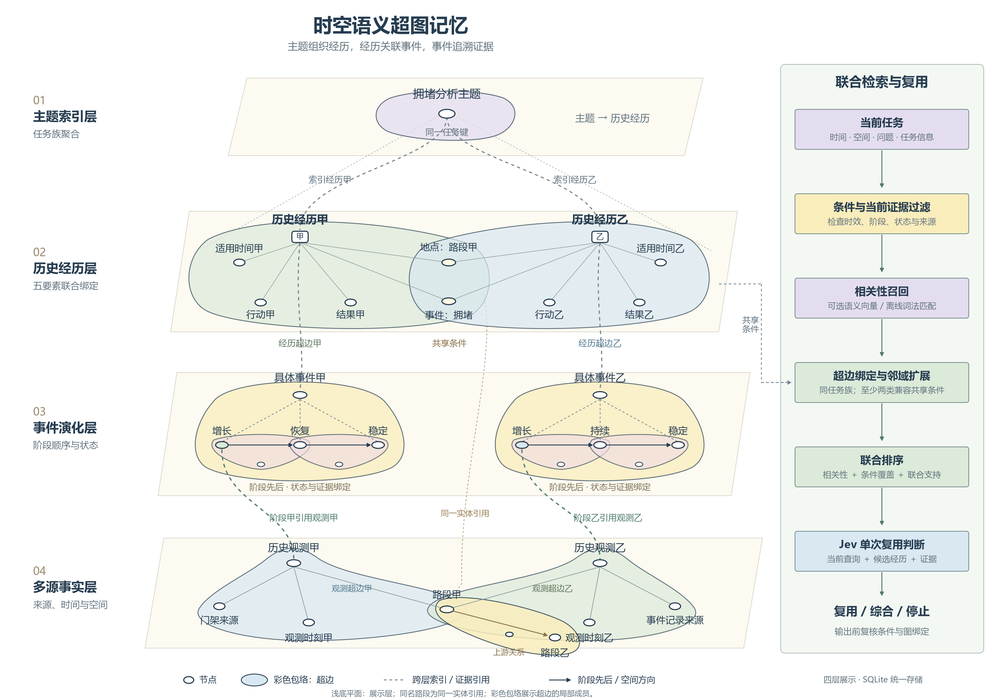

# 时空语义超图记忆：四层扁平结构

自上向下依次为主题索引层、历史经历层、事件演化层和多源事实层。浅米色平面引导层次，空心椭圆表示节点，彩色闭合轮廓表示超边，灰色虚线表示跨层索引或成员引用。小方框“甲、乙”表示记忆记录索引，不是新增节点类型。

- 主题以任务键聚合经历。经历甲、乙通过各自的经历超边联合绑定时间、地点、事件、行动和结果，并在兼容的地点、事件节点处交叠；各自的行动和结果仍独立保存。
- 两条经历分别关联事件甲、乙，事件内部横向展开阶段。粉色超边表示阶段转移，深色箭头表示源阶段到目标阶段的时间顺序，小节点表示方向描述。阶段到观测的绿色虚线表示其证据引用。
- 观测超边分别关联观测、来源、观测时刻和空间实体。观测甲、乙各自保存时间与来源，并共享路段甲；黄色空间关系超边关联路段甲、上游关系描述和路段乙，金色箭头表示空间关系方向。
- 经历层与事实层的路段甲是同一实体的两次展示，细金色虚线表示同一实体引用，不新增存储节点。超边完整成员可以跨展示层；图中轮廓表示局部成员投影，并非完整超边只能包含轮廓内所绘字段。

右侧为当前实现的简化检索顺序：当前任务 → 条件与当前证据过滤 → 相关性召回 → 超边绑定检查及受约束邻域扩展 → 联合排序 → Jev 单次复用判断。只有同一任务族内至少共享两类查询兼容条件的经历才能扩展；每条经历仍需独立通过约束与绑定检查。向量语义召回需要配置向量服务，默认离线相关性是 TF-IDF 词法匹配。

图示强调三个设计特点：五要素经历联合绑定；事件阶段与多源证据可追溯；时空、语义与任务约束参与联合检索。交通内容仅为说明结构的示例，阶段先后不表示因果关系，图示本身不代表实验性能结论。

四层是统一 SQLite 超图的展示视图，未新增存储层、节点类型或算法能力。具体行为参见 [联合检索说明](../../JOINT_RETRIEVAL_GUIDE.md)。

文件：`hypergraph-memory-paper-flat.png`（4080 × 2856）、`hypergraph-memory-paper-flat.svg`（可编辑中文文本）、`hypergraph-memory-paper-flat.pdf`（嵌入字体）。绘图脚本：`draw_memory_paper_flat.py`。

## 输出检查

Python 源码预检无失败项。三个提示分别是使用 PNG 预览而非 TIFF、预览采用 300 dpi、画布宽度为演示尺寸；本次是结构讨论图而非已排版的期刊投稿图，保留 SVG/PDF 用于后续排版。已检查 PNG 的中文字体、层间连接、轮廓重叠与图例；SVG 保留文本元素。图中不包含实验数据，因此没有数据筛选、统计量或样本数。
