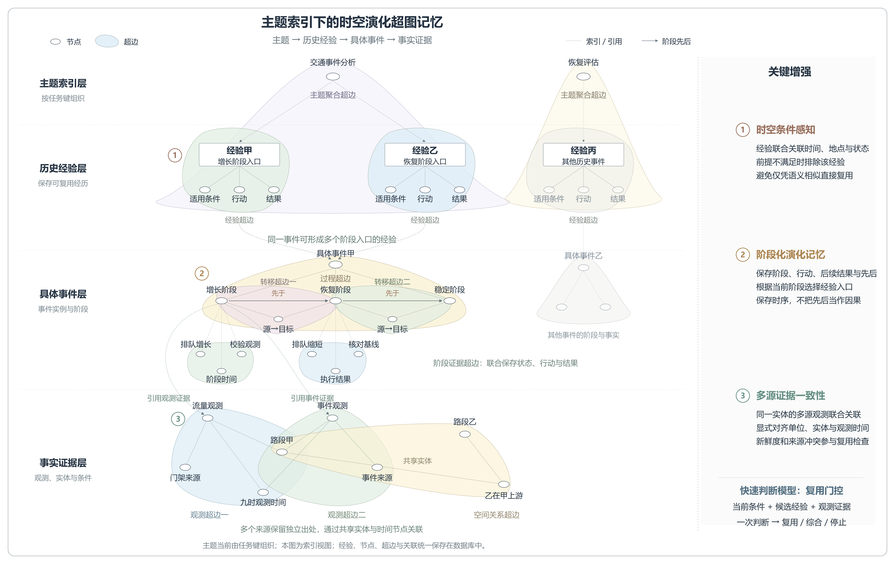

# 主题索引下的时空演化超图记忆

此为旧版示意。当前推荐图见 [经历组织与联合检索](hypergraph-memory-theme-retrieval.md)，已改为两条历史经验分别关联自己的事件，并展开五要素经历组织和联合检索。

本图按“主题 → 历史经验 → 具体事件 → 事实证据”自上向下展开，参照用户提供的论文图使用小节点、浅色闭合超边和明确的层间引用。此层次是超图的索引展示视图，不是新增四个数据库或严格的树形存储。

主题当前对应 intent 节点与按任务键聚合的 family 超边，没有声称实现自动语义主题聚类。经验甲、乙是记忆记录索引，分别以增长、恢复阶段为复用入口，可以关联同一个历史事件实例。事件实例对应 process 节点，阶段、阶段证据及有向转移对应已有 evolution 结构。

底层多源观测保存独立出处，共享时空实体。图中同一个“路段甲”和“九时观测时间”节点被两条观测超边共同引用；空间关系超边也关联该路段实体。层内细线是超边成员关系的可视化投影，不表示系统另外保存了这些普通二元边。

右侧三项重点表达当前方法的结构增强：时空条件感知、阶段化演化记忆、多源证据一致性；快速判断模型对应 Jev 的单次记忆复用门控。它们属于研究设计与已实现机制，图本身不证明学术新颖性或效果优越。自动事件抽取、自动主题聚类、因果发现、传播预测未画为已实现能力。

可编辑文件：hypergraph-memory-theme-innovation.svg。高清图为 4000 × 2520 PNG。重绘源文件：draw_memory_theme_innovation.py，复用 draw_memory_reference_style.py 中的 SVG 基础绘制函数。
