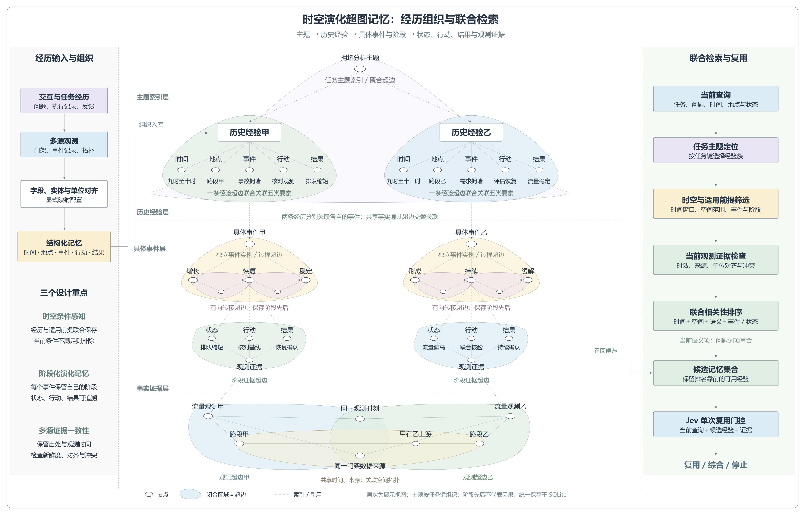

# 时空演化超图记忆：经历组织与联合检索

本图是当前推荐版本，纠正上一版将经验甲、乙同时连接到事件甲的表达。按用户约定的主干展开：拥堵分析主题分别索引历史经验甲、历史经验乙；两段经历分别关联具体事件甲、具体事件乙，各自保存阶段序列，再关联状态、行动、结果与观测证据。实现允许同一事件保存多条经验入口，但本图选择两个独立事件来解释结构，不表示经验必须一对一绑定事件。

## 五要素经历组织

每条经验用一条 episode 超边联合关联时间、地点、事件类别、行动、结果；可同时包含适用条件、回答、验证证据及过程演化等其他成员，图中未全部展开。历史经验的矩形是 Record 记录索引，不是新增的一类节点。主题由 intent 与按任务键聚合的 family 超边表示，当前没有自动语义主题聚类。

事件实例用 process 表示，身份包含记忆作用域、会话以及 namespace、case_id。event 字段是事件类别，不能替代事件实例标识。process 超边组织阶段；state_transition 超边包含源阶段、目标阶段及显式有向转移描述；stage_evidence 超边关联阶段、状态、行动、结果、阶段时间和引用观测。图中事件的阶段、节点值和交通内容是结构示例，未表示已有真实交通实验结果。

底层两条 observation 超边各自关联观测、实体、来源和观测时刻。这里使用同一来源、同一观测时刻的两个路段观测，展示共享节点；空间关系超边连接两个路段及方向描述。多源冲突检查支持不同来源的观测，本图底层只画一组共享来源示例。图中不同层重复出现的路段标签是同值节点的引用投影；实际系统通过节点类型与值生成确定性标识。闭合区域表示多元超边，内部细线只是成员关系投影，不表示额外创建普通二元边。四层是索引展示视图，存储仍统一在 SQLite。

## 联合检索与 Jev

右侧按当前实现的顺序展示：

1. 使用可选任务键选择经验族，并检查记忆生命周期与会话范围。
2. 检查适用条件、时间窗口、空间范围、事件类别、入口阶段、当前状态；排除查询时刻尚未产生的历史结果。
3. 使用当前查询的观测进行证据检查，包含实体与单位匹配、质量、新鲜度、时间对齐、来源数量及冲突要求。
4. 对可用候选结合词项重合、时间、空间、事件、阶段、状态及证据要求数量进行启发式排序，返回 Top-K。任务信息主要通过经验族定位和条件过滤参与，不是额外的连续评分。该排序不是学习到的概率模型；当前“语义”项是问题词项重合，没有向量编码器。
5. Jev 接收当前查询、候选经验及证据，一次判断记忆复用。门控不能替代事实验证或任务执行验证。

时间、地点、事件、行动、结果不是新增的五个存储层，而是经验超边联合组织的成员。索引层次解决查找入口，五要素绑定保留经历条件和内容，阶段超边保存演化，多维筛选与排序决定当前能否使用这些经历。

当前结构具有时空条件感知、阶段化演化记忆、多源证据一致性机制，但本图不能证明学术新颖性或效果优越。自动经历抽取、自动主题聚类、向量语义检索、因果发现与超图传播推理未画作已实现能力。

可编辑源图：[SVG](hypergraph-memory-theme-retrieval.svg)。高清 PNG 为 4280 × 2740。重绘脚本：draw_memory_theme_retrieval.py，复用 draw_memory_reference_style.py 的 SVG 基础绘制函数。
